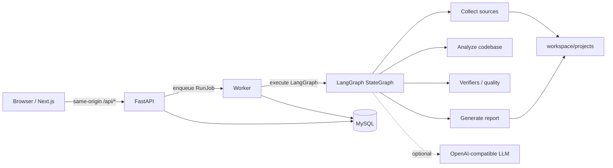

# 架构说明

> 配套文档：[项目现状与评审说明](STATUS.md)。本文描述**当前实现**，不是目标设计。

## 1. 总体结构



- **Next.js** 负责中文工作台；浏览器只访问同源 `/api/*`，由 Next.js rewrite 转发到 FastAPI。
- **FastAPI** 只做校验、持久化、入队和读取；长任务由独立 Worker 执行。
- **LangGraph** 在 Worker 进程中执行可 checkpoint 的 Loop；支持暂停等待回答和恢复。
- **MySQL** 保存项目、输入源、扫描地图、运行、证据、发现、风险、问题、质量分、报告、LLM 调用、run events、run jobs 和 graph checkpoint。
- **workspace/projects** 保存 clone 的仓库和扫描工作区；不提交到 Git。

## 2. 配置与启动

| 组件 | 命令 | 默认端口 |
| --- | --- | --- |
| API | `uv run python -m uvicorn app.main:app --reload --host 127.0.0.1 --port 8002` | 8002 |
| Worker | `uv run python -m app.workers.worker_service --queue default --poll-interval 2` | - |
| Web | `npm run dev -- --hostname 127.0.0.1 --port 3000` | 3000 |

`start-all.ps1` 负责启动 API、Worker 和 Web，并可选启动 MySQL；MySQL 路径通过 `LOOP_MYSQLD_PATH` / `LOOP_MYSQL_INI_PATH` 传入，不写死本机路径。

## 3. 一次自动调研的流程

```text
POST /projects/setup
  -> 校验 research_profile、source type 和 URI
  -> 原子创建 Project + Source + RunJob
  -> Worker 领取 job

Worker: execute_workflow
  1. collection  采集资料，写 SourceSnapshot / CodebaseMap
  2. analysis    build_context -> analyze_sources -> optional LLM analyzer
                 -> persist -> verify_package -> quality score
  3. architecture 根据 CodebaseMap 生成 Mermaid 架构图（按 run 保存）
  4. report      create_intelligent_report_snapshot
                 -> deterministic markdown + optional LLM sections
```

- 进度来自 `workflow_stage_*` run events，而不是内存状态。
- 每个阶段完成后再进入下一阶段；已完成阶段在重试时复用。
- 运行可以 `paused_for_input` 等待用户回答高影响问题，然后 `POST /runs/{id}/resume`。
- Worker 用 lease/heartbeat 防止重复领取；`run_worker.py` 负责过期 job 恢复。

## 4. 数据模型

核心表：

| 表 | 作用 |
| --- | --- |
| `projects` | 项目配置、调研方式、状态 |
| `sources` | 输入类型和规范化 URI |
| `source_snapshots` | 采集摘要和失败原因 |
| `codebase_maps` | 只读扫描结果：技术栈、入口、依赖、测试、文件树 |
| `analysis_runs` | 一次 Loop 运行和最终状态 |
| `loop_turns` | 每个节点的动作、观察和元数据 |
| `evidence_items` | 可追溯证据 |
| `findings` / `risks` | 发现与风险，必须引用 evidence |
| `questions` | 需要用户回答的问题 |
| `recommendations` | 结论和下一步 |
| `quality_scores` | 六维质量评分 |
| `report_snapshots` | 固定下来的 Markdown 报告和 verifier 结果 |
| `llm_calls` / `llm_*_artifacts` | 模型调用、分析/报告增强产物和校验结果 |
| `run_jobs` / `run_events` | 队列、租约、阶段事件 |
| `architecture_diagrams` | 按 run 保存的图、结构快照和查看状态 |

## 5. 扫描与「项目速览」

`app/tools/code_scan_tools.py`：

- 只读遍历目录，不跟随 symlink，不执行脚本。
- 过滤 `.env` / key / pem 等敏感路径、`vendor`、`third_party`、`hack`、`public`、`__pycache__`、构建产物和大型生成文件。
- 识别依赖清单、配置、测试、入口和主语言。
- 入口支持 Next.js App Router、React、Express/Node、Python 和 Go `cmd/`。
- 主语言按核心源码文件数量判断，避免一两个脚本污染技术栈。

`app/reports/project_brief.py`：

- 从 README 提取定位、背景、功能表格、运行命令和证据来源。
- 清理空 Markdown 链接、徽章、HTML 和表格分隔符。
- 资料不足时写入 `gaps`，不推测不存在的事实。

`app/reports/renderer.py`：

- 先渲染「项目速览」，再按 `ResearchProfile.section_plan` 渲染各章节。
- 证据、发现、风险、报告和校验附录统一渲染。
- 项目速览中的「依据」列出 README 路径/章节、能力表行数、代码扫描事实。

## 6. 调研方式与报告

五种方式定义在 `app/research/profiles.py`，每种包含：

- `audience` / `core_question` / `deliverable`
- `checklist` / `focus_points`
- `section_plan`：有序章节与每节要回答的问题
- `analysis_directives`：给确定性分析和 LLM 的约束

后端 `profile_analysis.py` 生成档位特定的发现/风险/建议；`renderer.py` 用同一份 `section_plan` 渲染；`services/reports.py` 把同一份章节计划传给 LLM，`llm_generator.py` 把模型段落合并回对应章节。

## 7. 证据与确定性校验

- `verify_analysis_package` 检查结构、证据覆盖、代码覆盖、风险透明度、问题关闭率、质量分和档位检查。
- `score_analysis_package` 使用档位权重评分；分数决定 run 结束状态。
- LLM 分析和报告增强都必须通过 JSON 结构校验、evidence id 校验和长度限制；失败时保留确定性结果。
- LLM 提出的高影响问题在持久化时降级为 advisory，并保留 `original_impact` 元数据，避免自动任务无限暂停。

## 8. 报告与导出

- 每次生成报告都会创建 `report_snapshots` 记录，历史报告按 `run_id`/`report_id` 保留。
- 报告导出文件名：`项目名-调研方式-调研报告-日期-报告短ID.md/pdf`。
- 智能报告在确定性正文上追加模型段落；没有模型时回退为确定性正文。
- 人工评审（通过 / 要求补充 / 驳回）改变报告和项目状态，不覆盖历史快照。

## 9. 安全边界

- 只读调研；不执行被分析项目代码。
- LLM 不能新增未落库证据；引用只能来自 allowed evidence ids。
- `.env`、运行日志、克隆目录和依赖目录不进入 Git；仓库只提供 `.env.example`。
- 前端同源代理避免跨域；服务端默认只绑定 `127.0.0.1`。

## 10. 已知架构缺口

- 没有编译级依赖图（Go import / Java class / Python import graph）。
- 架构图和时序图是静态阅读骨架，不是运行时调用链。
- 多代码库同时输入时，架构图基于最近一次代码库地图。
- 没有分布式队列；Worker 使用 MySQL job 表和 lease，适合单机/小规模部署。
- 没有多租户、RBAC 和细粒度权限；当前按本地单用户设计。
